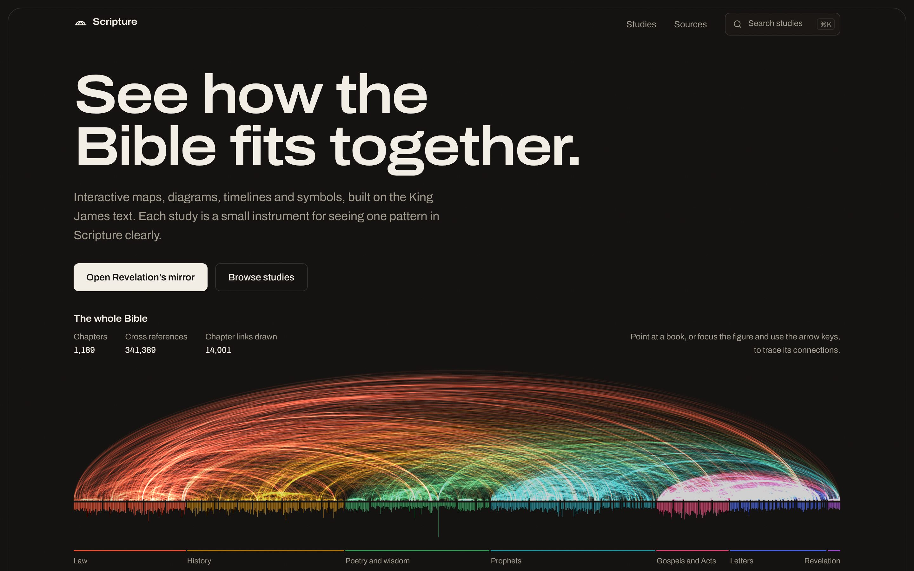
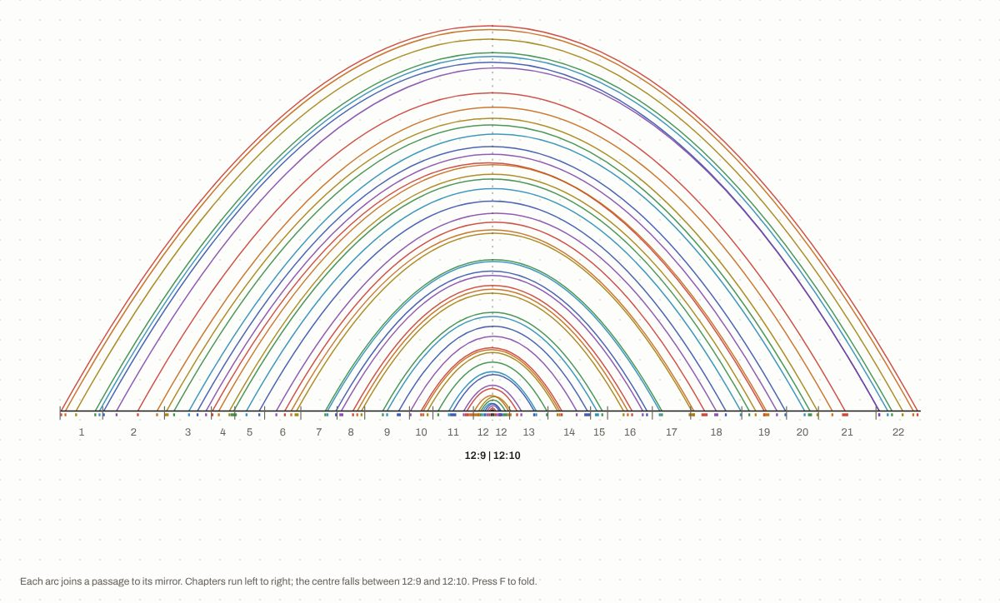

<p align="center">
  
</p>

<h1 align="center">Scripture Tools</h1>

<p align="center">
  <strong>See how the Bible fits together.</strong><br>
  Interactive maps, diagrams, timelines and symbols for studying the Bible,<br>
  each one a small, focused tool built on the King James text.
</p>

<p align="center">
  <a href="https://scripturetools.vercel.app">Scripture Tools</a>
  &nbsp;·&nbsp;
  <a href="#the-text-stays-as-it-is">Our principles</a>
  &nbsp;·&nbsp;
  <a href="CONTRIBUTING.md">Contribute</a>
  &nbsp;·&nbsp;
  <a href="../../issues/new/choose">Report a mistake</a>
</p>

<p align="center"><em>Soli Deo Gloria</em>: to God alone be the glory.</p>

---

## What this is

Scripture is a growing set of **studies**: visual, interactive tools that help
you see what is already in the Bible. Each study takes one thing (the shape of a
book, a journey, a family line, a pattern of words) and draws it, with every
verse one click away.

Every study is its own small app with the same frame: an outline on the left,
the picture in the middle, the verses and details on the right. You can search
for any study, book or verse from anywhere with <kbd>⌘K</kbd>, and every view
has a link you can share.

## Studies

<!-- studies:start · generated by `npm run docs:studies` from src/studies/registry.ts; don't edit by hand -->
<table>
<tr>
<td valign="top" width="280">
<a href="https://scripturetools.vercel.app/studies/revelation-chiasm"></a><br>
<strong><a href="https://scripturetools.vercel.app/studies/revelation-chiasm">Revelation's mirror</a></strong><br>
Revelation is built as a mirror around 12:9–10. Follow 51 paired passages from the first verse to the centre and back out.
</td>
</tr>
</table>

[See every study](docs/STUDIES.md): 1 live and 24 planned.
<!-- studies:end -->

## The text stays as it is

> Ye shall not add unto the word which I command you, neither shall ye diminish
> *ought* from it.
>
> Deuteronomy 4:2

This project makes tools for reading the Bible. It does not add to the Bible,
take from it, or speak for it. Every study, and every contribution, starts from
three commitments.

1. **The text is never changed.** Every verse on the site is the King James
   Version, the standard 1769 text, exactly as published, including the
   italic words the translators supplied. Nothing is paraphrased, shortened,
   modernised or reordered. The text is generated from its source and checked
   by tests (66 books, 1,189 chapters, 31,102 verses); nobody edits it by hand.
2. **Show, don't teach.** A study shows where things are in the text and how
   they relate: how often, how far apart, in what order, in what place. It
   does not argue for a doctrine, a denomination's reading, or one
   interpretation of prophecy. Readers draw their own conclusions, with the
   verses in front of them.
3. **Name everything that comes from outside the text.** Maps, dates, ancient
   places, literary structures and cross references come from scholars and
   open datasets. Each one is credited where it appears, called a
   reconstruction or a proposal when that is what it is, and set beside the
   verses so anyone can check it. Where careful readers disagree, a study
   shows the alternatives rather than choosing one.

Christians from many traditions read the same Scripture. We want every one of
them to be able to use these tools and trust that the Bible they see is the
Bible they know.

## Contributing

You don't need to write code to help. The most valuable contributions are
often a careful eye: a verse reference that's off by one, a label that reads
more into the text than is there, a place on a map with a better source.

- **[Report a mistake](../../issues/new?template=report-a-mistake.yml)** in a study's text, data or labels
- **[Suggest a study](../../issues/new?template=suggest-a-study.yml)** or an improvement to one
- **[Tell us something is broken](../../issues/new?template=something-is-broken.yml)**
- **Build something.** Start with [CONTRIBUTING.md](CONTRIBUTING.md)

Every study also has a **Contribute** button in its top bar that opens these
forms with the study and your exact view already filled in.

Please read the [code of conduct](CODE_OF_CONDUCT.md) before you join a
discussion.

## For developers

<details>
<summary><strong>Run it on your computer</strong></summary>

You need [Node.js](https://nodejs.org) 20.9 or newer (22 recommended).

```bash
git clone https://github.com/digitalreliance/scripturetools.git
cd scripturetools
npm install
npm run dev          # http://localhost:3000
```

```bash
npm test             # data and logic tests
npm run lint
npm run build        # the static production build
npm run typecheck    # after a build or a dev run, which generate route types
```

The datasets are committed under `public/data`, so you don't need to download
anything else. To rebuild them from their sources:

```bash
npm run data:kjv     # the King James Version from eBible.org
npm run data:xrefs   # cross references from OpenBible.info
```

</details>

<details>
<summary><strong>How it's built</strong></summary>

A fully static [Next.js](https://nextjs.org) site in TypeScript: every page is
prerendered, so it loads fast, costs almost nothing to host, and has no
accounts, tracking or database. Diagrams are SVG drawn with d3's maths, dense
pictures use Canvas and WebGL2, and the design is our own, built with Tailwind
CSS and Radix.

```
src/app          routes, kept thin
src/studies      one folder per study, and the registry that lists them all
src/components   the study frame, the index page, verse text, the ⌘K palette
src/lib          the canon, references, data loaders, site settings
public/data      generated datasets (never edited by hand)
scripts/data     the pipelines that build them
scripts/docs     the README gallery and docs/STUDIES.md, from the registry
docs/            architecture, design system, and every dataset's source
```

Read next:

- [docs/ARCHITECTURE.md](docs/ARCHITECTURE.md): the stack, how studies plug in, the roadmap
- [docs/DESIGN.md](docs/DESIGN.md): principles, colour, type, layout, motion, writing
- [docs/data/](docs/data/): where each dataset comes from, its licence and how it's processed
- [CLAUDE.md](CLAUDE.md): conventions for working in the code (also read by AI coding tools)

</details>

## Sources and licences

| What | Source | Licence |
|---|---|---|
| The code | This repository | [MIT](LICENSE) |
| The Bible text | King James Version, standard 1769 text, from [eBible.org](https://ebible.org/) | Public domain |
| Cross references | [OpenBible.info](https://www.openbible.info/labs/cross-references/), adapted to KJV verse numbering | [CC BY 4.0](https://creativecommons.org/licenses/by/4.0/) |
| Revelation's mirror | A chiasm chart of Revelation; distances recounted from the KJV | See [docs/data/revelation-chiasm.md](docs/data/revelation-chiasm.md) |

The MIT licence covers the code. The datasets keep their own licences, listed
above and in [docs/data/](docs/data/); if you reuse them, credit them as their
licences ask.

## Soli Deo Gloria

> Not unto us, O LORD, not unto us, but unto thy name give glory, for thy
> mercy, *and* for thy truth’s sake.
>
> Psalm 115:1

This work is offered to the glory of God alone. It carries no one's name, and
everyone who contributes does so on the same terms.
