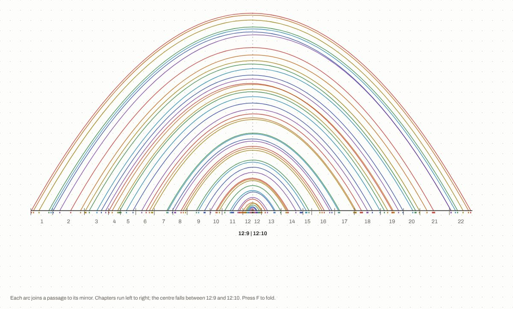

<!-- Generated by `npm run docs:studies` from src/studies/registry.ts; don't edit by hand. -->

# Studies

Every study in Scripture Tools, by section: 1 live and 24 planned. Live studies open on [the site](https://scripturetools.vercel.app); planned ones are on the way. To suggest one, use the [study form](../../../issues/new?template=suggest-a-study.yml).

## The text

The King James Bible itself, with the italics, red letters and paragraph marks its printers set.

Planned:

- **King James reader.** All 66 books with the translators' italics, red letters and paragraph marks, plus cross references for every verse.
- **Word explorer.** Every word of the King James text counted and charted across the 66 books.

## Structure

How books are built: mirrored halves, outlines and acrostics.

### [Revelation's mirror](https://scripturetools.vercel.app/studies/revelation-chiasm)

Revelation is built as a mirror around 12:9–10. Follow 51 paired passages from the first verse to the centre and back out.

- **Book:** Revelation
- **Mirrored pairs:** 51
- **Views:** Chart, arcs, symmetry and text

Sources: [King James Version (1769 text), eBible.org](https://ebible.org/) (Public domain).

Planned:

- **Chiasms across Scripture.** The same mirrored design in the Flood narrative, the Psalms and the Gospels.
- **Book blueprints.** Each book's outline drawn as a single plan you can zoom from sections to verses.

## Maps and places

Journeys, borders and cities on the land they describe.

Planned:

- **Paul's journeys.** Four voyages across the Roman world, port by port, with the verses for every stop.
- **The Exodus route.** From Rameses to the plains of Moab through the camps listed in Numbers 33.
- **The twelve tribes.** The tribal allotments of Joshua 13–21 drawn on the land they describe.
- **Jerusalem through time.** The city's walls, gates and temple from David to the Roman siege.

## Time

Reigns, lifespans and events laid out on one scale.

Planned:

- **Kings of Israel and Judah.** Two lines of kings side by side, with the prophets who spoke to each.
- **The long lives of Genesis.** The ages in Genesis 5 and 11 drawn to scale, showing whose lives overlapped.
- **The last week.** Each day from the entry into Jerusalem to the empty tomb, across all four Gospels.

## People

Families, tribes and the twelve, traced through the text.

Planned:

- **From Adam to Christ.** The genealogies of Genesis, Chronicles, Matthew and Luke joined into one tree.
- **The twelve.** Each apostle's name, family, calling and every verse that mentions him.

## Symbols

Numbers, colours, creatures and objects, and every place they recur.

Planned:

- **Numbers in Scripture.** Where three, seven, twelve and forty recur, and what each occurrence counts.
- **The tabernacle.** Exodus 25–40 built in three dimensions to its stated cubits, piece by piece.
- **Revelation's imagery.** Colours, creatures, metals and stones in Revelation, each traced to its Old Testament source.

## Language and type

Hebrew and Greek letters, names, and the typography of the King James page.

Planned:

- **The alphabet psalm.** Psalm 119's twenty-two stanzas, each opening with the next letter of the Hebrew alphabet.
- **Reading the KJV page.** Why some words are italic, why LORD is set in small capitals, and what the ¶ marks.
- **Names and meanings.** Hebrew and Greek names, what they mean, and everyone who bore them.

## Prophecy

Visions in sequence: Daniel's kingdoms, the seventy weeks, the sevens of Revelation.

Planned:

- **Daniel's statue.** The four metals of Daniel 2 beside the four beasts of Daniel 7.
- **The seventy weeks.** Daniel 9:24–27 as a timeline you can set to each major reading.
- **Seals, trumpets and bowls.** Revelation's three cycles of seven aligned so you can see what repeats.

## Connections

Cross references and quotations that tie the testaments together.

Planned:

- **Cross-reference atlas.** Every chapter's links to the rest of the Bible, filtered by book, chapter or verse.
- **The Old in the New.** Every New Testament quotation of the Old, with both passages side by side.
